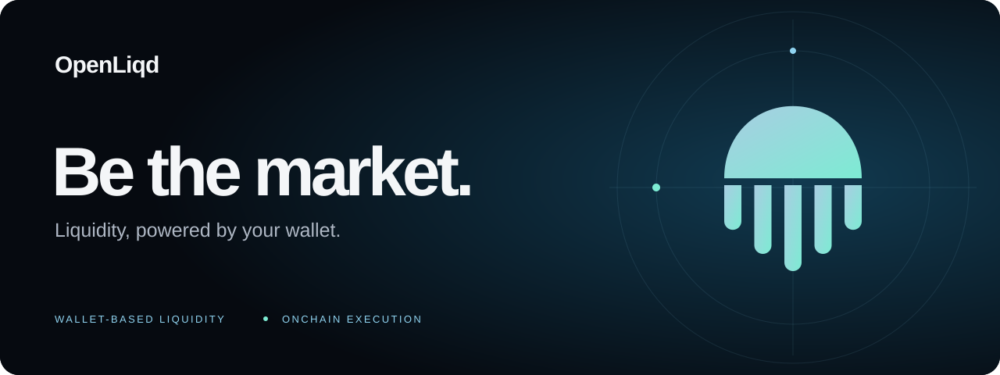

  

# OpenLiqd on GitHub

The public home of OpenLiqd's organization profile and shared contribution guidance.

**[Visit the organization →](https://github.com/openliqd)**

| File                                            | Purpose                                                     |
| :---------------------------------------------- | :---------------------------------------------------------- |
| [Organization profile](profile/README.md)       | The presentation shown on the organization's Overview page. |
| [Brand banner](assets/banner.svg)               | The banner used in the profile and this repository.         |
| [Contribution guide](CONTRIBUTING.md)           | Commit conventions, PR writing and evidence expectations.   |
| [PR template](.github/PULL_REQUEST_TEMPLATE.md) | A short writing guide for contributors.                     |

This repository contains presentation and community files. Protocol implementations, deployments and releases have their own repositories and lifecycle.

To improve the profile, open a focused pull request. Check image rendering, links and the accuracy of product claims before submitting.
